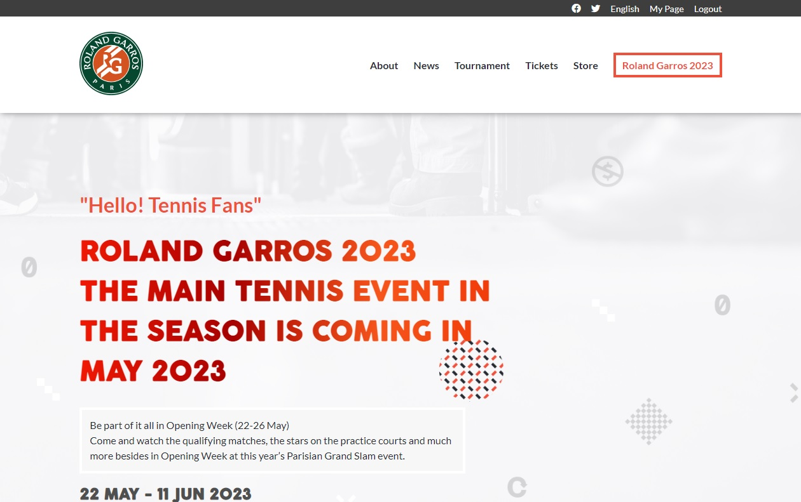
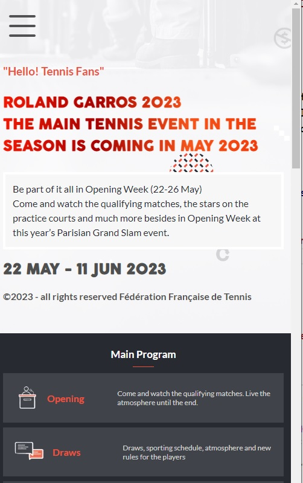

# Capstone Project: Roland Garros 2023

# 


> This is the first capstone project from microverse. this project is a website to promote the Roland Garros tournament, where people can know additional info about the tournaments and some featured players. It was built using HTML/CSS and Javascript

## Screenshots

- **Laptops/Desktops:**

---
# 


- **Mobile:**

---
# 


# 📗 Table of Contents

- [📖 About the Project](#about-project)
  - [🛠 Built With](#built-with)
    - [Tech Stack](#tech-stack)
    - [Key Features](#key-features)
  - [🚀 Live Demo](#live-demo)
- [💻 Getting Started](#getting-started)
  - [Setup](#setup)
  - [Prerequisites](#prerequisites)
  - [Install](#install)
  - [Usage](#usage)
  - [Run tests](#run-tests)
  - [Deployment](#triangular_flag_on_post-deployment)
- [👥 Authors](#authors)
- [🔭 Future Features](#future-features)
- [🤝 Contributing](#contributing)
- [⭐️ Show your support](#support)
- [🙏 Acknowledgements](#acknowledgements)
- [📝 License](#license)

# 📖 HTML/CSS & JavaScript capstone project - Model: Conference page <a name="about-project"></a>

**First capstone project** is a web page where you can find information about Rolland Garros Tournament.<br>

In [this video](https://www.loom.com/share/4f041649025548649006fb8bf20d2b74) you can find more information about this project.

## 🛠 Built With <a name="built-with"></a>

### Tech Stack <a name="tech-stack"></a>

  <ul>
    <li><a href="https://developer.mozilla.org/es/docs/Web/HTML">HTML</a></li>
  </ul>

  <ul>
    <li><a href="https://developer.mozilla.org/es/docs/Web/CSS">CSS</a></li>
  </ul>

   <ul>
    <li><a href="https://developer.mozilla.org/es/docs/Web/JavaScript">JavaScript</a></li>
  </ul>

### Key Features <a name="key-features"></a>

- ** Roland Garros 2023 **

<p align="right">(<a href="#readme-top">back to top</a>)</p>

## 🚀 Live Demo <a name="live-demo"></a>

- [Live Demo Link](https://first-capstone-project-tau.vercel.app/)

<p align="right">(<a href="#readme-top">back to top</a>)</p>

## 💻 Getting Started <a name="getting-started"></a>

To get a local copy up and running, follow these steps.

### Prerequisites

In order to run this project you need:

Text Editor 

### Setup

Clone this repository to your desired folder:

```
  cd my-folder
  git clone git@github.com:jlcarrasco/first-capstone-project.git 
```

### Install

Install this project with:

You don´t need to install this project

### Usage

To run the project, execute the following command:

```
  code first-capstone-project
```
### Run tests

To run tests, run the following command:

No tests available 

### Deployment

You can deploy this project using:

Browser (Chrome recommended)

<p align="right">(<a href="#readme-top">back to top</a>)</p>

## 👥 Authors <a name="authors"></a>

👤 Javier J. Martínez F.

- GitHub: [@jlcarrascof]
- Twitter: [@javiersistemas]

<p align="right">(<a href="#readme-top">back to top</a>)</p>

## 🔭 Future Features <a name="future-features"></a>

No future features

<p align="right">(<a href="#readme-top">back to top</a>)</p>

## 🤝 Contributing <a name="contributing"></a>

Contributions, issues, and feature requests are welcome!

Feel free to check the [issues page](../../issues/).

<p align="right">(<a href="#readme-top">back to top</a>)</p>

## ⭐️ Show your support <a name="support"></a>

If you like this project please contribute to make it better.

<p align="right">(<a href="#readme-top">back to top</a>)</p>

<!-- ACKNOWLEDGEMENTS -->

## 🙏 Acknowledgments <a name="acknowledgements"></a>

I'd like to give all my best wishes to you guys at Microverse community.

<p align="right">(<a href="#readme-top">back to top</a>)</p>

## 📝 License <a name="license"></a>

This project is [MIT](./MIT.md) licensed.

Original design idea by [Cindy Shin in Behance](https://www.behance.net/adagio07).

The original design is under [Creative Commons license of the design](https://creativecommons.org/licenses/by-nc/4.0/).

Multimedia and content changes were made in this project.

<p align="right">(<a href="#readme-top">back to top</a>)</p>
